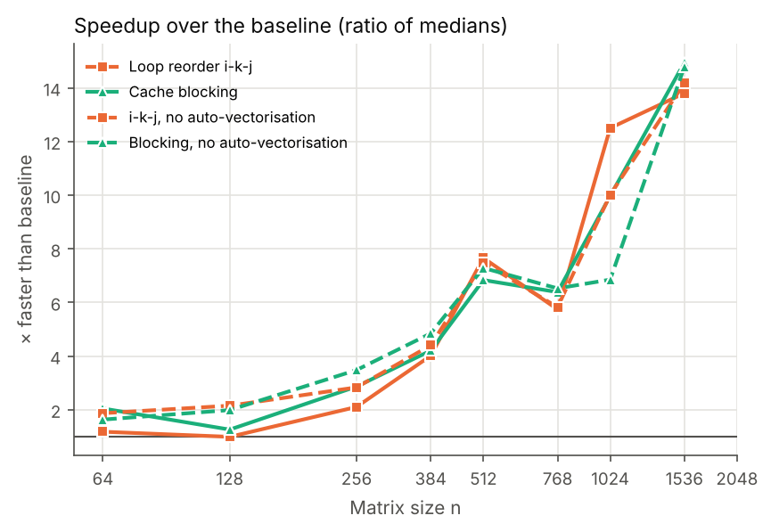
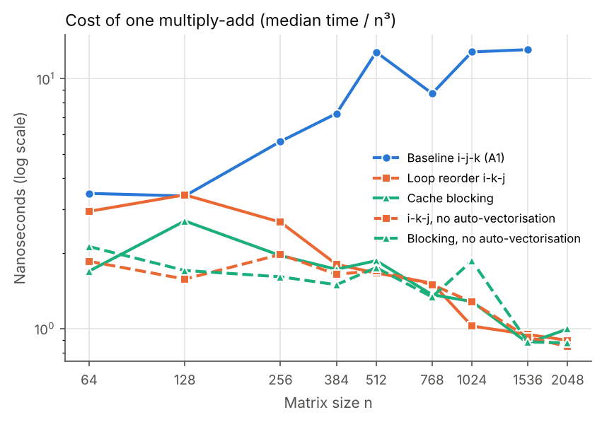
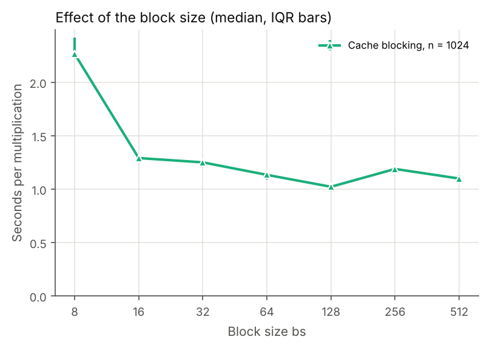
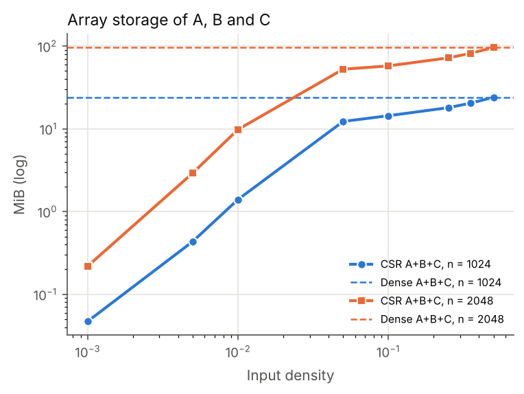

# Abstract

I studied two ways of making the basic triple-loop matrix multiplication from Assignment 1
faster in Java. In Part A, I compared the Assignment 1 i-j-k loop with two sequential
optimisations, loop reordering (i-k-j) and cache blocking, on the same dense float64 inputs
for n = 64 to 2048. In Part B, I compared my own sparse multiplication in CSR format
(Gustavson's algorithm) with dense blocked multiplication on exactly the same matrices, for
densities from 0.1 % to 50 % at n = 1024 and 2048. All methods give bitwise-identical
results. For n ≥ 1024 both optimisations were 10 to 15 times faster than the baseline, and
the cost of one multiply-add fell from about 13 ns to about 1 ns. At n = 2048 the baseline
did not finish one multiplication within the 60 s budget, while the optimised versions took
7.7 to 8.5 s. Blocking was not consistently faster than plain loop reordering: their
differences (−8 % to +25 %) were of the same size as the variation between separate runs of
the same configuration (up to 1.28×). Turning off the JIT's auto-vectorisation made no
consistent difference (it only helped clearly at n = 1024). The sparse kernel was 24 to 32 000 times faster than dense up to 5 %
density, 1.8 to 2.2 times faster at 35 %, and as fast or slightly slower at 50 %. The product
of two random sparse matrices fills in quickly: at 5 % input density the output is already
92–99 % nonzero. The CSR arrays were smaller than the dense ones up to 35 % density and the
same size at 50 %. These results apply to the tested implementations, inputs and laptop
(Intel Core i5-5350U, 2 cores, 8 GB RAM, macOS).

# 1. Introduction and objective

In Assignment 1 the time per multiply-add of the Java i-j-k loop grew about 9 times between
small and large matrices, because the inner loop reads B down a column and stops using the
caches well once B no longer fits in them. Assignment 2 tests whether changing only the
memory-access pattern removes that penalty, and whether skipping zeros helps when most
entries are zero.

**Research questions.**

* **A.** How much do loop reordering and cache blocking reduce the runtime of the
  Assignment 1 baseline in Java, and how does the gain depend on n?
* **B.** For matrices with a uniform random pattern of nonzeros, below which density is a
  CSR multiplication faster and smaller than dense multiplication of the same matrices,
  and how much do the conversion to CSR and the fill-in of the product change that?

**Hypotheses** (written before running the study):

* H1: for small n (data in cache) the three dense kernels take similar time; the speedup of
  ikj and blocked over the baseline grows once B no longer fits in the caches.
* H2: blocking beats plain ikj only for the largest n, where a row of B and C no longer fits
  in the caches between uses; with intermediate n the two are close.
* H3: part of the ikj gain comes from the JIT vectorising the contiguous inner loop, which
  the column access of the baseline prevents; disabling auto-vectorisation reduces but does
  not remove the gain.
* H4: the sparse kernel's time grows roughly with the number of products n³d² (d = density),
  while dense time does not depend on d; sparse wins below some density d\* and loses above.
  Because CSR needs 12 bytes per stored entry against 8 for dense, and the product fills in,
  sparse storage stops being smaller at a lower density for C than for A and B.

# 2. Background

**Loop order.** C = AB can be computed with the three loops in any order. In the i-j-k
order each C[i][j] is a dot product, and B is read with a stride of n elements. In the
i-k-j order the inner loop computes C[i][:] += A[i][k] · B[k][:], so B and C are read with
unit stride, which uses whole cache lines and lets the hardware prefetcher work [1], [2].
A contiguous loop of this form can also be vectorised; the HotSpot C2 compiler does this
automatically ("SuperWord"), and it can be turned off with `-XX:-UseSuperWord`.

**Blocking (tiling).** Even in i-k-j order, every row i of C streams the whole of B through
the caches. Blocking splits the loops into tiles of bs × bs so that the tiles in use stay in
cache and are reused before being evicted [3], [4]. With three tiles of 8·bs² bytes,
bs = 64 needs 96 KiB, which fits in the 256 KiB L2 cache per core of my CPU [5]. The best
block size depends on the machine, so I also measured several sizes.

**Sparse matrices and CSR.** Compressed Sparse Row stores, for each row, the column indices
and values of its nonzero entries, plus an array of n + 1 row pointers [6]. With 32-bit
indices and 64-bit values it needs 12 bytes per nonzero plus 4(n+1) bytes, so it only saves
memory below about 2/3 density. Gustavson's algorithm [7] computes C one row at a time:
row i of C is the sum of the rows k of B weighted by the nonzeros A[i][k]. Its work is
proportional to the number of nonzero products, not to n³. Like SciPy's implementation
[8], mine first counts the nonzeros of each row of C (symbolic pass), then allocates C
exactly and computes the values (numeric pass), using a dense accumulator and a marker array
of length n. For a uniform pattern with density d, the expected number of products is
n³d², and the expected density of C is 1 − (1 − d²)ⁿ, which approaches 1 when nd² is
large: the product fills in [9].

**Correctness.** As in Assignment 1, I used the forward error bound of a dot product,
|ĉ − c| ≤ γₙ |a|ᵀ|b| with γₙ = nu/(1 − nu), u = 2⁻⁵³ [10], to compare with NumPy. Because
Java does not reassociate floating-point operations or fuse them into FMA (JEP 306), kernels
that add the same products in the same order give bitwise-identical results.

# 3. Methodology

## 3.1 Implementations

All code is Java 17 (compiled with `javac --release 17`), sequential, float64, with matrices
stored as one contiguous row-major `double[]`.

| Method | Description | Timed region includes |
|---|---|---|
| `baseline` | Assignment 1 i-j-k loop, copied unchanged (repo `amaisuarez/assignment1`, commit `754ec23`) | the three loops |
| `ikj` | loops j and k swapped; A[i][k] kept in a register | zeroing C (O(n²)) + loops |
| `blocked` | i-k-j inside 64 × 64 tiles, tile loops ii → kk → jj; edge tiles for any n | zeroing C + loops |
| `ikj_novec`, `blocked_novec` | same code, JVM flag `-XX:-UseSuperWord` (auxiliary, to isolate SIMD) | as above |
| `sparse` | CSR × CSR → CSR, Gustavson, two passes, dense accumulator; own code | allocation of C and work arrays + both passes |

Table: **Table 1.** Implementations.

For every C[i][j], all dense kernels add the products in increasing k starting from 0.0, so
they only change the order in which different entries of C are computed. The sparse kernel
adds the same nonzero products in the same order (only the ±0.0 terms are missing), so it
gives the same values. The sparse output keeps column indices in order of first appearance
(not sorted) and keeps entries that cancel to exactly zero.

## 3.2 Inputs

* **Part A:** the dense Assignment 1 inputs, regenerated with the same script and seed
  (`20262027`); values uniform in [−1, 1); SHA-256 checked against the Assignment 1 manifest.
* **Part B:** for each n ∈ {1024, 2048} and density d ∈ {0.001, 0.005, 0.01, 0.05, 0.1,
  0.25, 0.35, 0.5}, two matrices where every position is nonzero independently with
  probability d (uniform random pattern), with values uniform in [−1, 1) and no exact zeros.
  Seeds are `20262027:n:d:A|B`. They are stored once in COO format and **both** the sparse
  and the dense method read the same file: the dense method expands it into a dense array
  before the timer starts, and the sparse method builds CSR. The realised nnz (Table 5) is
  within 1.4 % of d·n² in every case except the smallest one (n = 1024, d = 0.001: 1007 and
  1027 nonzeros against 1049 expected, about one standard deviation of the binomial count).

## 3.3 Environment

Intel Core i5-5350U (2 physical cores, 4 logical processors, 1.8 GHz), 8 GB RAM, macOS, on
mains power. Java: OpenJDK 21.0.6 (JetBrains Runtime build 21.0.6+9-b895.97), the same JVM
as in Assignment 1. Harness and analysis: Python 3.13.5. Each configuration ran in a new JVM
with `-XX:+UseSerialGC -Xms256m -Xmx4g`. Besides the single application thread, the JVM runs
its own threads (JIT compiler, garbage collector); no library with its own thread pool is
used. As in Assignment 1, macOS did not let me pin the process to a core or disable Turbo
Boost. The benchmark processes ran for about 25 minutes in total (run
`results/run_20261026-153110`).

## 3.4 Correctness

`tests/validate.py` ran before the benchmarks: 112 checks, all passed
(`results/validation_report.txt`). It checks identity, zero and a hand-computed 2 × 2 for
every method; that ikj and blocked (block sizes 1, 3, 7, 16, 64, 128, including sizes that
do not divide n) are **bitwise equal** to the baseline for n from 1 to 130; that the baseline
is within 2γₙ|A||B| of NumPy; and that, for n up to 200 and densities 0 to 1 (including
empty rows), the sparse result equals the dense baseline value by value and its nnz equals
the nnz of the boolean product of the patterns. In the benchmark itself, all Part A methods
produced the same checksum at every n (one distinct value per n), and in Part B the sparse
and dense methods reported the same nnz of C.

## 3.5 Measurement protocol

* **Timing boundary:** the multiplication kernel only (Table 1). Reading files and creating
  the dense C array are outside. The COO → CSR conversion of A and B is timed separately,
  5 times per configuration, and reported both alone and added to the sparse time.
* **Timer and dead-code protection:** `System.nanoTime()`; the sum of C is printed after
  every repetition.
* **Warm-up:** 3 rounds for n ≤ 512 and 1 for larger n, each lasting at least 100 ms,
  excluded from the statistics. The batch size (multiplications per repetition) comes from
  the last warm-up round so that each repetition lasts about 100 ms; for n ≥ 384 it is 1 or 2.
* **Repetitions and statistics:** 5 measured repetitions per configuration; I report the
  median and the interquartile range (IQR) of the time per multiplication. All raw values
  are in `raw_measurements.csv`.
* **Order:** method order shuffled with a fixed seed for each size (and each density).
* **Budgets, declared before running:** 60 s per repetition and 4 GB of estimated array
  storage. Failures are recorded as `timeout` or `skipped_memory_budget`, and larger n (or,
  in Part B, higher densities) are then not attempted for that method.
* **Memory:** (1) analytical array storage of A, B and C (dense 8n² bytes each; CSR
  12·nnz + 4(n+1) each); (2) peak RSS of the process (`ru_maxrss` on macOS), which includes
  the JVM and the heap it reserves. I compare (1) across methods and report (2) as a
  process-level measure with its limitation.
* **Block size:** fixed at 64 for Parts A and B; a separate sweep at n = 1024 measured
  bs ∈ {8, 16, 32, 64, 128, 256, 512}.

# 4. Results

## 4.1 Part A: dense optimisations

| n | Baseline | IQR/med. | ikj | IQR/med. | Speedup | Blocked | IQR/med. | Speedup |
|---:|---:|---:|---:|---:|---:|---:|---:|---:|
| 64 | 0.910 ms | 78 % | 0.771 ms | 850 % | 1.2 | 0.444 ms | 6 % | 2.0 |
| 128 | 7.11 ms | 64 % | 7.18 ms | 163 % | 1.0 | 5.64 ms | 22 % | 1.3 |
| 256 | 94.0 ms | 79 % | 44.7 ms | 42 % | 2.1 | 32.8 ms | 13 % | 2.9 |
| 384 | 410 ms | 16 % | 102 ms | 30 % | 4.0 | 97.6 ms | 5 % | 4.2 |
| 512 | 1.71 s | 8 % | 224 ms | 0.5 % | 7.7 | 251 ms | 8 % | 6.8 |
| 768 | 3.95 s | 4 % | 687 ms | 9 % | 5.7 | 618 ms | 4 % | 6.4 |
| 1024 | 13.72 s | 2 % | 1.10 s | 2 % | 12.5 | 1.38 s | 1 % | 10.0 |
| 1536 | 47.31 s | 23 % | 3.43 s | 6 % | 13.8 | 3.17 s | 4 % | 14.9 |
| 2048 | timeout | – | 7.69 s | 2 % | > 7.8 | 8.54 s | 8 % | > 7.0 |

Table: **Table 2.** Time per multiplication (median of 5 repetitions), IQR relative to the
median, and speedup = median(baseline) / median(method). At n = 2048 the baseline's warm-up
multiplication had not finished after 60 s, so only a lower bound of the speedup is given.

The baseline's cost per multiply-add rose from 3.4 ns at n = 64–128 to 12.8–13.1 ns for
n ≥ 1024. The ikj and blocked kernels went the other way: from 1.7–3.4 ns at small n down to
0.9–1.3 ns for n ≥ 1024, so the speedup over the baseline grew with n, from about 1–2 at
n ≤ 128 to 4 at n = 384, 6–8 at n = 512–768 and 10–15 at n = 1024–1536 (Figure 2). At
n = 2048 the baseline exceeded the 60 s budget in its warm-up multiplication; at its
n = 1536 cost per multiply-add it would need about 112 s. Its largest completed size was
n = 1536; every optimised method completed n = 2048.

**Variability.** For n ≥ 768 the IQR was small (median 3.6 % of the median time, at most
25 %). For n ≤ 384 it was large (median 24 %, up to 850 %): in 15 of the 25 Part A
configurations with n ≤ 512 the slowest repetition was more than 1.5 times the fastest,
with isolated repetitions up to 24 times slower than the others in the same process
(`raw_measurements.csv`). Speedups for n ≤ 384 in Table 2 are therefore only indicative.

**Loop reordering against blocking.** Blocked/ikj ratios of the medians were 1.12, 0.90,
1.25, 0.92 and 1.11 for n = 512, 768, 1024, 1536 and 2048: neither was consistently faster.
To see how large a difference has to be to mean something, I compared the runs of exactly the
same configuration (blocked, bs = 64) in separate JVMs, which the study already contains:
Part A, the block sweep and the dense side of Part B (the inputs differ but the dense kernel
does the same n³ work on them).

| n | Processes | Range of medians | Max / min | Part A run |
|---:|---:|---:|---:|---:|
| 1024 | 10 | 1.078 – 1.376 s | 1.28 | 1.376 s (slowest) |
| 2048 | 9 | 7.068 – 8.543 s | 1.21 | 8.543 s (slowest) |

Table: **Table 3.** The same kernel (blocked, bs = 64) measured in separate JVMs.

In both cases the Part A process was the slowest of its group; the other nine (eight) were
within 1.078–1.156 s (7.07–8.25 s).

**Auto-vectorisation.** With `-XX:-UseSuperWord`, the ratio vectorised / not vectorised was
0.98, 1.01, 0.80, 1.03 and 1.06 for ikj and 1.07, 1.02, 0.69, 0.99 and 1.14 for blocked
(n = 512 … 2048). Only n = 1024 clearly favoured the vectorised code. For ikj the difference
there (1.25×) is about the size of the process-to-process range in Table 3; for blocked,
`blocked_novec` took 2.00 s, outside the 1.08–1.38 s range of the vectorised kernel at that
size. At the other sizes the differences were within ±14 % and changed sign.

## 4.2 Block size

| bs | 8 | 16 | 32 | 64 | 128 | 256 | 512 |
|---|---:|---:|---:|---:|---:|---:|---:|
| Tile memory 3·8·bs² | 1.5 KiB | 6 KiB | 24 KiB | 96 KiB | 384 KiB | 1.5 MiB | 6 MiB |
| Median time | 2.266 s | 1.291 s | 1.251 s | 1.134 s | 1.022 s | 1.189 s | 1.099 s |
| IQR | 178 ms | 34 ms | 12 ms | 56 ms | 20 ms | 23 ms | 39 ms |

Table: **Table 4.** Blocked kernel at n = 1024 with different block sizes.

Only bs = 8 was clearly worse (2.27 s). From bs = 16 to 512 the medians stayed between
1.02 and 1.29 s, a 1.26× range, similar to the process-to-process range in Table 3. The
fastest was bs = 128 (1.02 s), 10 % faster than the bs = 64 used in the study.

## 4.3 Part B: sparse vs dense

| n | d | nnz A | nnz C | Out. dens. | Sparse | Conversion | Dense | Dense / sparse | incl. conv. |
|---:|---:|---:|---:|---:|---:|---:|---:|---:|---:|
| 1024 | 0.001 | 1 007 | 1 052 | 0.001 | 38.2 µs | 195 µs | 1.104 s | 28 890 | 4 732 |
| 1024 | 0.005 | 5 210 | 26 500 | 0.025 | 376 µs | 1.22 ms | 1.104 s | 2 935 | 694 |
| 1024 | 0.01 | 10 340 | 100 489 | 0.096 | 1.19 ms | 1.04 ms | 1.100 s | 928 | 494 |
| 1024 | 0.05 | 52 478 | 966 873 | 0.922 | 45.8 ms | 1.41 ms | 1.080 s | 23.6 | 22.9 |
| 1024 | 0.1 | 104 502 | 1 048 535 | 1.000 | 94.4 ms | 1.68 ms | 1.088 s | 11.5 | 11.3 |
| 1024 | 0.25 | 262 641 | 1 048 576 | 1.000 | 424 ms | 5.95 ms | 1.156 s | 2.73 | 2.69 |
| 1024 | 0.35 | 366 738 | 1 048 576 | 1.000 | 489 ms | 10.3 ms | 1.078 s | 2.20 | 2.16 |
| 1024 | 0.5 | 524 860 | 1 048 576 | 1.000 | 1.106 s | 7.45 ms | 1.086 s | 0.98 | 0.98 |
| 2048 | 0.001 | 4 226 | 8 646 | 0.002 | 230 µs | 704 µs | 7.436 s | 32 315 | 7 959 |
| 2048 | 0.005 | 21 076 | 211 204 | 0.050 | 4.88 ms | 827 µs | 7.422 s | 1 520 | 1 300 |
| 2048 | 0.01 | 41 889 | 772 611 | 0.184 | 26.7 ms | 2.52 ms | 7.104 s | 266 | 243 |
| 2048 | 0.05 | 209 658 | 4 169 290 | 0.994 | 265 ms | 4.11 ms | 7.686 s | 29.0 | 28.5 |
| 2048 | 0.1 | 419 278 | 4 194 304 | 1.000 | 633 ms | 9.95 ms | 7.068 s | 11.2 | 11.0 |
| 2048 | 0.25 | 1 046 876 | 4 194 304 | 1.000 | 2.036 s | 9.51 ms | 7.161 s | 3.52 | 3.50 |
| 2048 | 0.35 | 1 467 865 | 4 194 304 | 1.000 | 4.024 s | 15.7 ms | 7.182 s | 1.78 | 1.78 |
| 2048 | 0.5 | 2 099 432 | 4 194 304 | 1.000 | 9.003 s | 24.0 ms | 8.245 s | 0.92 | 0.91 |

Table: **Table 5.** Sparse (CSR) against dense (blocked, bs = 64) on the same inputs:
medians of 5 repetitions per multiplication. "incl. conv." adds the median COO → CSR
conversion time of A and B to the sparse time. nnz B is within 2 % of nnz A in every case
(`report/tables/part_b_time.md`).

{width=100%}

The dense time did not depend on the density (1.08–1.16 s at n = 1024; 7.07–7.69 s at
n = 2048, plus 8.25 s at d = 0.5). The sparse time grew by more than four orders of
magnitude between d = 0.001 and 0.5. Sparse was faster up to d = 0.35 at both sizes
(by 2.20× and 1.78×) and as fast or slightly slower at d = 0.5 (0.98× and 0.92×), so the
crossover lies between 35 % and 50 % density. The conversion took between 0.2 and 24 ms.
It was longer than the kernel itself for d ≤ 0.005 at n = 1024 and d = 0.001 at n = 2048,
and including it lowered the dense/sparse ratio by 47–84 % at n = 1024 for d ≤ 0.01 and at
n = 2048 for d = 0.001, by 9–14 % at n = 2048 for d = 0.005–0.01, and by at most 3 % from
d = 0.05 on. Even with the conversion, sparse stayed more than 240 times faster for d ≤ 0.01.

| n | d | Products | n³d² | Sparse ns / product | Dense ns / multiply-add | √(dense / sparse cost) |
|---:|---:|---:|---:|---:|---:|---:|
| 1024 | 0.01 | 105 569 | 1.07·10⁵ | 11.2 | 1.02 | 0.30 |
| 1024 | 0.1 | 10 652 662 | 1.07·10⁷ | 8.86 | 1.01 | 0.34 |
| 1024 | 0.25 | 67 107 547 | 6.71·10⁷ | 6.31 | 1.08 | 0.41 |
| 1024 | 0.35 | 131 221 905 | 1.32·10⁸ | 3.73 | 1.00 | 0.52 |
| 1024 | 0.5 | 268 850 250 | 2.68·10⁸ | 4.11 | 1.01 | 0.50 |
| 2048 | 0.01 | 854 031 | 8.59·10⁵ | 31.3 | 0.83 | 0.16 |
| 2048 | 0.1 | 85 867 807 | 8.59·10⁷ | 7.37 | 0.82 | 0.33 |
| 2048 | 0.25 | 535 923 952 | 5.37·10⁸ | 3.80 | 0.83 | 0.47 |
| 2048 | 0.35 | 1 052 732 442 | 1.05·10⁹ | 3.82 | 0.84 | 0.47 |
| 2048 | 0.5 | 2 151 013 765 | 2.15·10⁹ | 4.19 | 0.96 | 0.48 |

Table: **Table 6.** Work of the sparse kernel. Products = Σₖ nnz(A[:,k]) · nnz(B[k,:]),
counted exactly from the input files. Last column: the density at which sparse and dense
would take the same time if the cost per operation stayed as measured at that density
(all densities in `report/tables/part_b_work.md`).

The exact number of products matched n³d² within 1.5 % (Table 6). The sparse cost per
product was not constant: it was between 11 and 36 ns for d ≤ 0.05 (without a clear trend
inside that range), 7.4–8.9 ns at d = 0.1 and 3.7–4.2 ns at d ≥ 0.35. The dense cost per
multiply-add stayed between 0.82 and 1.08 ns. At high density one sparse product therefore
cost about 4–5 dense multiply-adds, and the density at which the two balance,
√(dense cost / sparse cost), came out as 0.47–0.52 for d ≥ 0.35.

The output density matched 1 − (1 − d²)ⁿ: 0.096 and 0.184 at d = 0.01 (expected 0.097 and
0.185), 0.92 and 0.99 at d = 0.05, and 1.000 from d = 0.1 on (Figure 6).

| n | d | nnz C | CSR A+B+C | of which C | Dense A+B+C | Sparse peak RSS | Dense peak RSS |
|---:|---:|---:|---:|---:|---:|---:|---:|
| 1024 | 0.001 | 1 052 | 0.05 MiB | 0.02 MiB | 24.0 MiB | 107.1 MiB | 62.4 MiB |
| 1024 | 0.01 | 100 489 | 1.4 MiB | 1.2 MiB | 24.0 MiB | 111.8 MiB | 63.2 MiB |
| 1024 | 0.05 | 966 873 | 12.3 MiB | 11.1 MiB | 24.0 MiB | 141.5 MiB | 66.3 MiB |
| 1024 | 0.35 | 1 048 576 | 20.4 MiB | 12.0 MiB | 24.0 MiB | 163.7 MiB | 90.4 MiB |
| 1024 | 0.5 | 1 048 576 | 24.0 MiB | 12.0 MiB | 24.0 MiB | 184.4 MiB | 102.5 MiB |
| 2048 | 0.001 | 8 646 | 0.2 MiB | 0.1 MiB | 96.0 MiB | 109.2 MiB | 136.3 MiB |
| 2048 | 0.01 | 772 611 | 9.8 MiB | 8.9 MiB | 96.0 MiB | 102.9 MiB | 138.3 MiB |
| 2048 | 0.05 | 4 169 290 | 52.5 MiB | 47.7 MiB | 96.0 MiB | 276.4 MiB | 145.8 MiB |
| 2048 | 0.35 | 4 194 304 | 81.6 MiB | 48.0 MiB | 96.0 MiB | 408.3 MiB | 263.7 MiB |
| 2048 | 0.5 | 4 194 304 | 96.1 MiB | 48.0 MiB | 96.0 MiB | 523.6 MiB | 312.6 MiB |

Table: **Table 7.** Memory. Array storage is analytical (dense 8 bytes per element; CSR 12
bytes per nonzero + row pointers). A dense C needs 8 MiB (n = 1024) or 32 MiB (n = 2048).
Peak RSS is per process and includes the JVM. All densities in `report/tables/part_b_memory.md`.

In array storage, CSR was smaller than dense up to d = 0.35 and equal at d = 0.5 (Table 7).
For C alone, CSR was already larger than dense from d = 0.05 (11.1 against 8 MiB at
n = 1024; 47.7 against 32 MiB at n = 2048), because C was almost full and CSR needs 12
instead of 8 bytes per entry; the total stayed smaller only because A and B were small. Peak
RSS did not follow the array storage: the sparse processes had a higher peak than the dense
ones in every case except n = 2048 with d ≤ 0.01.

**Variability and warm-up in Part B.** The dense side was stable (IQR at most 9 % of the
median). The sparse side was less so (IQR up to 70 %). In three configurations (n = 1024,
d = 0.35 and n = 2048, d = 0.25 and 0.35) the first two measured repetitions were about 1.7
times slower than the last three (e.g. n = 2048, d = 0.35: 6.48 and 6.94 s, then 3.83, 3.83
and 4.02 s), which gives IQRs of 63–66 %; the median fell on the faster group. The other large
IQRs (n = 1024, d = 0.001; n = 2048, d = 0.005 and 0.01) belong to kernels that took between
0.04 and 27 ms, where single slow repetitions weigh more.

# 5. Discussion

## H1 – the gain grows with n (supported)

For n ≤ 128 the optimised kernels were at most about 2 times faster than the baseline, and
these numbers are noisy; from n = 256 the speedup grew steadily to 10–15 for n ≥ 1024. This
matches the cost per multiply-add: the baseline's grew about four times between n = 128 and
n ≥ 1024, as in Assignment 1, while the i-k-j kernels got cheaper with n and reached
about 1 ns. The penalty of the baseline is therefore caused by its access pattern and not by the
amount of arithmetic, which is the same in all three. Reading B along rows instead of down
columns removed almost all of it.

## H2 – blocking beats ikj at large n (not supported)

Blocking with bs = 64 was not consistently faster than plain i-k-j: it was 8–10 % faster at
n = 768 and 1536 and 11–25 % slower at n = 512, 1024 and 2048. These differences are of the
same size as the spread between separate runs of the same configuration (1.21–1.28×,
Table 3), so this study cannot tell the two apart. The block-size sweep agrees: everything
between bs = 16 and 512 fell within a similar range. My interpretation, which I did not test
directly (for example with hardware counters), is that in the i-k-j order the inner loop
already streams two contiguous rows (16 KiB each at n = 2048), which the hardware prefetcher
handles well, so the remaining misses cost little on this CPU, while blocking shortens the
inner loop to 64 iterations and adds loop overhead. Blocking matters more when the kernel is
also register-blocked and vectorised, as in optimised libraries [4].

## H3 – vectorisation explains part of the gain (not supported)

Disabling auto-vectorisation did not reduce the gain in a consistent way. At n = 512, 768,
1536 and 2048 the non-vectorised kernels were within ±14 % of the vectorised ones, in both
directions, and they were still 7–15 times faster than the baseline. Only at n = 1024 did the
vectorised kernels do clearly better (1.25× for ikj and 1.45× for blocked). So almost all of
the gain over the baseline came from the memory-access pattern, not from SIMD code, with the
single exception of n = 1024, which I cannot explain from these data. I did not inspect the
generated machine code, so I cannot say whether C2 actually vectorised these loops in the
default runs; the result only shows that the flag made no consistent difference here. At about 1 ns per multiply-add (about 2 GFLOP/s), the kernels are far from
the CPU's peak, which is consistent with memory access, not arithmetic, being the limit.

## H4 – sparse wins below a crossover density (partly supported)

The dense time was independent of the density and the sparse time followed the number of
products, which was exactly n³d². The crossover was between 35 % and 50 %, much higher than
I expected. Table 6 explains why: on these inputs one sparse product cost only about 4 dense
multiply-adds at high density, so sparse wins while d² is below about 1/4, that is d below
about 0.5. The cost per product was higher at low density because the per-row work (marker
checks, writing column indices, the O(n) arrays) is spread over fewer products, and this
did not change the conclusion because sparse was hundreds or thousands of times faster
there. The conversion to CSR is O(nnz), so it only mattered when the kernel itself took
under a few milliseconds. For one multiplication of matrices that already arrive in a sparse
format, the conversion is a negligible cost.

The memory part of H4 was supported: the product fills in so fast that C was 92–99 % full at
5 % input density, and from there a CSR C was 1.5 times larger than a dense one. The total
CSR storage was still smaller up to 35 % only because A and B stayed sparse. In practice, the
output of a random sparse product is only worth storing as sparse when nd² is small (here,
d ≤ 0.01). Peak RSS mostly showed how much heap the JVM had reserved: the sparse process held
the COO input and the CSR copies and allocated a new C in every multiplication, so the heap
grew with garbage until it was collected. A comparison of memory between methods therefore
has to use the array storage, not the process RSS.

## Warm-up and variability

One warm-up round of at least 100 ms was not always enough for large n: in 36 of the 58
configurations with n > 512 the first measured repetition was more than 10 % above the
median, and for the sparse kernel at d = 0.25–0.35 the first two were. With 5 repetitions
the median stayed on the steady state in every case, but the IQRs are inflated. Georges et
al. recommend detecting steady state instead of using a fixed number of warm-up runs [11];
I will use more warm-up rounds, or steady-state detection, in Assignment 3.

The baseline was also slower than the same code in Assignment 1 on the same laptop and JVM
(1.2–1.3 times at n = 1024–1536 and 2–3 times at n ≤ 768). The cause is not known: the
machine state on the two days differed (the large variability at small n suggests background
activity during this run), and the A2 driver calls the kernel through a dispatch object
instead of directly. For this reason I compared methods only within the same run, where
they were interleaved in random order and shared the same conditions.

## Limitations

* One laptop and one run; absolute times and the crossover density are specific to it.
* Differences below about 1.3× between dense methods are not resolved by this design.
* The JIT decides by itself what to vectorise; the novec runs only switch off one optimisation.
* Peak RSS mostly reflects heap reserved by the JVM, not live data.
* Uniform random sparsity only; banded, block or power-law patterns change the number of
  products and the fill-in for the same density.
* The sparse output is not sorted by column; sorting would add cost.

# 6. Conclusions

* Changing only the loop order of the Assignment 1 multiplication made it 10–15 times faster
  for n ≥ 1024 on my laptop, and brought the cost of a multiply-add from about 13 ns to about
  1 ns. With it, n = 2048 takes about 8 s, while the baseline did not finish within 60 s.
* Cache blocking on top of that did not add a measurable gain in this setting, and
  auto-vectorisation only made a clear difference at one size (n = 1024): the improvement
  came from reading memory contiguously.
* For random sparse matrices, the CSR multiplication was faster than dense multiplication of
  the same matrices up to 35 % density, by factors from 1.8 to more than 30 000, and equal or
  slightly slower at 50 %. The crossover follows from the number of products (n³d²) and the
  cost per product, about 4 times the cost of a dense multiply-add.
* The product fills in quickly (C almost full from 5 % input density), so storing C as CSR
  costs more than storing it dense from that point; CSR saved memory overall up to 35 %
  density, but only thanks to A and B.
* A good choice therefore depends on the input: for dense matrices, i-k-j order; for sparse
  ones, CSR while nd² stays small, and dense (or a dense output) once the product fills in.

# Use of generative AI

I used Claude (Anthropic) to help design the experiment, to explain the techniques, to
generate the first versions of the code and scripts, and to help draft this report from my
results. I reviewed and ran all the code, I ran every experiment on my own laptop, and every
number in this report comes from those runs (`results/run_20261026-153110/`). I checked that
each reference exists and supports what I cite it for.

# References

[1] J. L. Hennessy and D. A. Patterson, *Computer Architecture: A Quantitative Approach*, 6th ed. Cambridge, MA, USA: Morgan Kaufmann, 2017.

[2] U. Drepper, "What every programmer should know about memory," Red Hat, Inc., Tech. Rep., 2007.

[3] M. D. Lam, E. E. Rothberg, and M. E. Wolf, "The cache performance and optimizations of blocked algorithms," in *Proc. ASPLOS IV*, 1991, pp. 63–74.

[4] K. Goto and R. A. van de Geijn, "Anatomy of high-performance matrix multiplication," *ACM Trans. Math. Softw.*, vol. 34, no. 3, Art. 12, 2008.

[5] TechPowerUp, "Intel Core i5-5350U," CPU Database. [Online]. Available: https://www.techpowerup.com/cpu-specs/core-i5-5350u.c1812

[6] Y. Saad, *Iterative Methods for Sparse Linear Systems*, 2nd ed. Philadelphia, PA, USA: SIAM, 2003.

[7] F. G. Gustavson, "Two fast algorithms for sparse matrices: Multiplication and permuted transposition," *ACM Trans. Math. Softw.*, vol. 4, no. 3, pp. 250–269, 1978.

[8] P. Virtanen *et al.*, "SciPy 1.0: Fundamental algorithms for scientific computing in Python," *Nature Methods*, vol. 17, pp. 261–272, 2020.

[9] T. A. Davis, *Direct Methods for Sparse Linear Systems*. Philadelphia, PA, USA: SIAM, 2006.

[10] N. J. Higham, *Accuracy and Stability of Numerical Algorithms*, 2nd ed. Philadelphia, PA, USA: SIAM, 2002.

[11] A. Georges, D. Buytaert, and L. Eeckhout, "Statistically rigorous Java performance evaluation," in *Proc. OOPSLA*, 2007, pp. 57–76.

**Reproducibility materials.** Code, raw data and analysis are in the folder
`matmul-assignment2/` that accompanies this report. The study is
`results/run_20261026-153110/`; `python3 scripts/analyze.py results/run_20261026-153110`
regenerates every table and figure from the raw data.

**GitHub repository:** <https://github.com/amaisuarez/assignment2>
